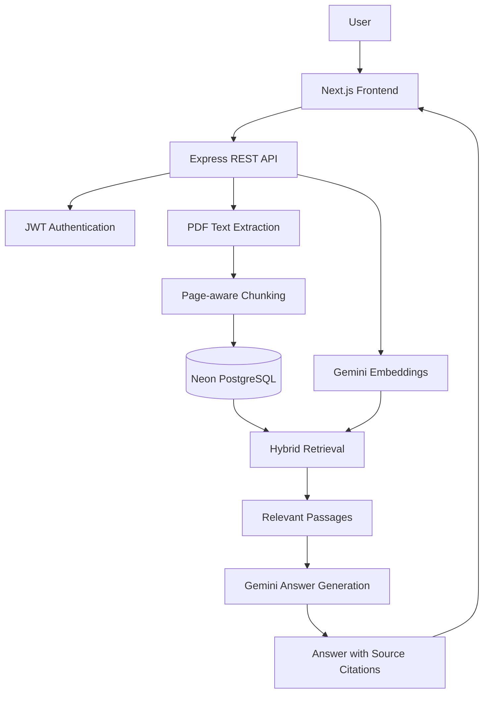

# DocuMind AI 📄🤖

<p align="center">
  <strong>Turn static PDFs into searchable knowledge.</strong><br />
  Upload documents, ask questions in natural language, and get AI-generated answers grounded in your files—with page-level source citations.
</p>

<p align="center">
  <a href="https://documind-ai-ashy-tau.vercel.app/"></a>
</p>

<p align="center">
  
  
  
  
  
  
</p>

## Overview

**DocuMind AI** is a full-stack document intelligence application that helps users find information inside PDF files without manually searching through every page. Users can create an account, upload a PDF, and ask questions about its contents. The backend retrieves relevant passages and uses Google Gemini to generate an answer with supporting document and page references.

The application is deployed with a **Next.js frontend on Vercel**, an **Express API on Render**, and a **PostgreSQL database hosted on Neon**.

## Live Application

| Component | Deployment |
|---|---|
| Web app | [Open DocuMind AI](https://documind-ai-ashy-tau.vercel.app/) |
| Backend API | [Render API](https://documind-ai-lsc1.onrender.com) |
| Health check | [Check API and database status](https://documind-ai-lsc1.onrender.com/api/health) |
| Source code | [GitHub repository](https://github.com/nirbhayyyy18/documind-ai) |

> **Note:** The backend is hosted on a free Render instance and may take a little time to respond after a period of inactivity. AI features also depend on Google Gemini API availability and quota.

## Features

- **Account authentication** — Register and log in with password-based authentication and JWTs.
- **PDF upload and text extraction** — Upload PDF documents and extract their text.
- **Page-aware chunking** — Split extracted content into smaller passages while retaining page references.
- **Semantic retrieval** — Create vector embeddings with Google's `gemini-embedding-001` embedding model.
- **Keyword retrieval** — Search for exact terms and relevant text using PostgreSQL full-text and keyword search.
- **Hybrid search** — Combine semantic and keyword rankings using Reciprocal Rank Fusion (RRF).
- **AI-generated answers** — Use Google Gemini to answer questions based on retrieved document passages.
- **Source citations** — Include document filenames and page references to help users verify answers.
- **Document ownership** — Scope document access and search operations to the authenticated user.
- **Protected API routes** — Require authentication for document and search operations.
- **Automated backend tests** — Cover authentication, document routes, and search behaviour.

## How It Works

1. A user registers or logs in.
2. The user uploads a PDF through the web application.
3. The backend extracts text and separates it into page-aware chunks.
4. Document metadata and chunks are stored in PostgreSQL.
5. Gemini generates embeddings for document chunks and the user's question.
6. Semantic retrieval and PostgreSQL keyword search independently find relevant passages.
7. Reciprocal Rank Fusion combines the retrieval rankings.
8. The retrieved passages are provided to Gemini as context for answer generation.
9. The application returns an answer with supporting source references, including filenames and page numbers.



## Tech Stack

### Frontend
- Next.js
- React
- TypeScript
- Tailwind CSS

### Backend
- Node.js
- Express.js
- TypeScript
- REST APIs
- JWT authentication
- bcrypt password hashing
- Multer and PDF text extraction with `pdf-parse`

### AI and Retrieval
- Google Gemini API via `@google/genai`
- `gemini-embedding-001` for embeddings
- Semantic retrieval
- PostgreSQL full-text and keyword search
- Reciprocal Rank Fusion (RRF)

### Database, Testing & Deployment
- PostgreSQL
- Neon
- Vitest
- Supertest
- Vercel (frontend)
- Render (backend)

## Getting Started Locally

### Prerequisites

Install the following:

- Node.js and npm
- PostgreSQL, or a PostgreSQL-compatible database
- A Google Gemini API key
- Git

### 1. Clone the repository

```bash
git clone https://github.com/nirbhayyyy18/documind-ai.git
cd documind-ai
```

### 2. Configure the backend

```powershell
cd backend
npm install
Copy-Item .env.example .env
```

Open `backend/.env` and configure the required values:

| Variable | Purpose |
|---|---|
| `DATABASE_URL` | PostgreSQL connection string; use this for a hosted database such as Neon |
| `GEMINI_API_KEY` | Google Gemini API key for embeddings and answer generation |
| `JWT_SECRET` | Random secret used to sign authentication tokens; use at least 32 characters |
| `FRONTEND_URL` | Frontend origin allowed by CORS, e.g. `http://localhost:3000` |
| `PORT` | API port; defaults to `5000` |
| `DB_HOST`, `DB_PORT`, `DB_NAME`, `DB_USER`, `DB_PASSWORD` | Optional local PostgreSQL connection settings when `DATABASE_URL` is not set |

Use your own API key and database credentials. Never commit real secrets or environment files to source control.

### 3. Create and initialize the database

Create a PostgreSQL database if you are using a local instance:

```sql
CREATE DATABASE documind_ai;
```

Apply the initial schema migration from the repository to a fresh database:

```text
backend/migrations/000_initial_schema.sql
```

If you are working with an existing database, back it up and check which migrations have already been applied before making schema changes.

### 4. Start the backend

From the `backend` directory:

```powershell
npm run dev
```

The API should be available at `http://localhost:5000`. You can check its status at `http://localhost:5000/api/health`.

### 5. Configure and start the frontend

Open a second terminal:

```powershell
cd frontend
npm install
```

Create `frontend/.env.local` with the following value for local development:

```env
NEXT_PUBLIC_API_URL=http://localhost:5000
```

Then start the frontend:

```powershell
npm run dev
```

Open [http://localhost:3000](http://localhost:3000) in your browser.

## API Overview

| Method | Endpoint | Description |
|---|---|---|
| `GET` | `/api/health` | Check API and database connectivity |
| `POST` | `/api/auth/register` | Register a user |
| `POST` | `/api/auth/login` | Log in |
| `GET` | `/api/documents` | List the authenticated user's documents |
| `POST` | `/api/documents/extract` | Upload a PDF and extract its text |
| `GET` | `/api/search?q=your-question` | Search documents and generate an answer |

Document and search endpoints require authentication. The search endpoint can also accept a `documentId` query parameter to scope the search to a specific document. Search questions are limited to 500 characters.

Example authorization header:

```http
Authorization: Bearer YOUR_JWT_TOKEN
```

For exact request bodies and response formats, refer to the backend route implementations.

## Database Design

The application uses three main PostgreSQL tables:

| Table | Purpose |
|---|---|
| `users` | User accounts and authentication-related data |
| `documents` | Uploaded document metadata, ownership, and status |
| `document_chunks` | Extracted passages, page references, and embedding vectors |

### Key design choices

- **Page-aware chunks:** Preserve page references so that answers can link back to the source location.
- **Hybrid retrieval:** Combine semantic search with keyword search to support both concept-based questions and specific terms.
- **Reciprocal Rank Fusion:** Combine result rankings without assuming the underlying search methods use comparable score scales.
- **Server-side authorization:** Enforce document ownership in backend operations, not just in the frontend.
- **Grounded generation:** Provide retrieved document passages as context to the answer-generation model so users can verify the response against citations.

## Testing

Run the backend tests from the `backend` directory:

```powershell
npm test
```

Run TypeScript type checking:

```powershell
npx tsc --noEmit
```

The backend test suite covers authentication, document routes, and search behaviour. Tests and type checks were passing during deployment preparation; run them again against your current checkout when making changes.

## Security Notes

- Keep `.env` and `.env.local` files out of Git.
- Never publish API keys, database connection strings, passwords, or JWT secrets.
- Use a strong, unique `JWT_SECRET` in production.
- Keep CORS configured to allow only the intended frontend origin.
- AI-generated responses can be inaccurate. Check important information against the cited passages.
- Protect user documents with server-side authorization checks.

## Current Limitations

- The application currently focuses on PDF documents.
- Text extraction quality depends on the PDF; scanned or image-only PDFs may require OCR support.
- Upload processing runs as part of the upload request rather than a separate background job.
- AI answer quality and availability depend on the retrieved passages and Gemini API availability, quota, and limits.
- The free backend hosting tier may introduce cold-start delays.

## Roadmap

Potential future improvements include:

- OCR for scanned and image-based PDFs
- Asynchronous document processing and progress updates
- Persistent chat history
- In-document highlighting for cited passages
- Expanded integration and authorization edge-case tests
- Performance optimizations for large document collections

These are planned improvements, not features currently claimed as implemented.

## Author

**Nirbhay Tiwari**  
B.E. Electronics & Computer Science Engineering  
Thakur College of Engineering & Technology, Mumbai, India

- GitHub: [@nirbhayyyy18](https://github.com/nirbhayyyy18)
- LinkedIn: [Nirbhay Tiwari](https://www.linkedin.com/in/nirbhayyyy18)

---

<p align="center">
  <sub>Built to make document knowledge easier to search, understand, and verify.</sub>
</p>
